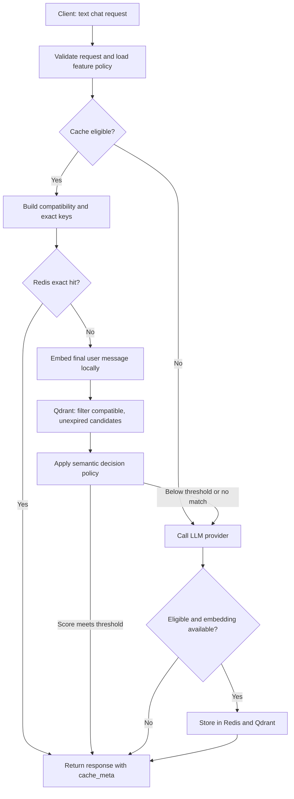

<div align="center">

# Semantic Cache Gateway

### Policy-Governed Caching for LLM APIs

**Reuse compatible answers. Reduce repeated provider calls. Inspect every cache decision.**

[](https://www.python.org/)
[](https://fastapi.tiangolo.com/)
[](https://redis.io/)
[](https://qdrant.tech/)

[](https://www.sbert.net/)
[](https://docs.pydantic.dev/)
[](https://prometheus.io/)
[](https://www.docker.com/)
[](LICENSE)

<p>
A FastAPI gateway that checks exact and semantic caches before calling an LLM provider.<br>
Feature policies control eligibility, similarity thresholds, user scope, and response lifetime.<br>
Every successful chat response includes structured metadata explaining the cache decision.
</p>

[Overview](#overview) · [Capabilities](#capabilities) · [Architecture](#architecture) · [Installation](#installation) · [Quick Demo](#quick-demo) · [API Reference](#api-reference) · [Operations](#operations)

</div>

---

## Overview

LLM applications often send the same questions repeatedly. Exact caching handles identical requests, but users also rephrase questions, change punctuation, and ask for the same information in different words.

Semantic Cache Gateway adds two cache layers in front of an OpenAI-compatible chat provider:

- **Redis** returns previously stored responses for identical, compatible requests.
- **Qdrant** finds semantically similar prompts using local sentence-transformer embeddings.

A similarity score alone does not determine whether an answer can be reused. The gateway also checks conversation context, model, generation settings, feature policy, tags, and user/session identity. Requests that cannot use a cached answer are forwarded to the provider.

The project makes the engineering tradeoff explicit: broader reuse can avoid more provider calls, while conservative policies limit reuse when context or meaning differs. Savings depend on the workload and should be measured against an all-provider baseline.

## Capabilities

| Capability | Behavior |
| --- | --- |
| Chat gateway | `POST /v1/chat/completions` accepts text conversations and returns provider-style choices, usage, and `cache_meta`. |
| Exact matching | SHA-256 keys preserve message content, including case and whitespace, and include compatibility settings. |
| Semantic matching | Local `all-MiniLM-L6-v2` embeddings produce 384-dimensional vectors for cosine search in Qdrant. |
| Context compatibility | Model, temperature, token limit, preceding messages, final message role, identity, tags, policy, and effective TTL partition lookup. |
| Feature policies | YAML configurations define thresholds, TTLs, user scope, and tag-based exclusions. |
| Identity isolation | Supplied user IDs and session IDs create separate cache partitions. Private requests without a user ID bypass caching. |
| Expiration | Redis TTLs and Qdrant expiry filters prevent expired entries from being served. |
| Request controls | Callers can disable caching or shorten the policy TTL for a request. |
| Cache seeding | A token-protected endpoint stores known answers in both caches for demonstrations and integration testing. |
| Failure handling | During request processing, cache lookup failures fall back to the provider; cache-write failures do not discard successful provider responses. |
| Observability | Prometheus counters and histograms expose cache outcomes, provider calls, errors, and latency. |

## Architecture



**Exact hit:** the provider is not called, and no embedding is generated for that lookup.

**Semantic hit:** the gateway embeds the final user message, retrieves compatible candidates, and serves an answer whose score meets the feature threshold.

**Miss or bypass:** the provider supplies the answer. Eligible responses are stored when an embedding is available. Borderline scores below the direct-hit threshold return a miss in this runtime; `cache_meta` identifies the judge-required band.

## Technology Stack

| Layer | Technology | Role |
| --- | --- | --- |
| Runtime | Python 3.11+ | Gateway and intelligence modules |
| API | FastAPI + Uvicorn | Async HTTP service and interactive documentation |
| Contracts | Pydantic v2 | Request validation and shared data structures |
| Provider adapter | OpenAI Python SDK | Calls to a configured compatible provider, including OpenRouter |
| Exact cache | Redis | Fast request lookup with TTL |
| Semantic store | Qdrant | Filtered vector retrieval and response metadata |
| Embeddings | Sentence Transformers / MiniLM | Local, normalized 384-dimensional embeddings |
| Policies | YAML | Per-feature cache behavior |
| Metrics | Prometheus Python client | Scrapeable counters and latency histograms |
| Infrastructure | Docker | Local Redis and Qdrant services |
| Tests | Python `unittest` | Cache compatibility and policy-rule checks |

## Installation

### 1. Prerequisites

Install the following on your computer:

- **Python 3.11 or newer**, including `pip` and virtual-environment support.
- **Git**, to clone the repository.
- **Docker Desktop** on Windows/macOS, or Docker Engine on Linux.
- A **provider API key** and a supported chat model identifier.

Internet access is needed to install dependencies, pull Docker images, download the embedding model, and call the provider. Embeddings are computed locally; model loading can also check Hugging Face for metadata.

### 2. Clone the repository

```sh
git clone https://github.com/kartik-707/Semantic-Cache-Gateway.git
cd Semantic-Cache-Gateway
```

Run the following commands from this project directory. If you already have a checkout, use it instead of cloning again.

### 3. Install dependencies

<details open>
<summary><strong>Windows — PowerShell</strong></summary>

```powershell
python -m venv venv
.\venv\Scripts\python.exe -m pip install --upgrade pip
.\venv\Scripts\python.exe -m pip install -r requirements.txt
```

These commands use the virtual environment directly, so activation or changes to PowerShell's execution policy are unnecessary. If `venv` already exists, skip its creation.

</details>

<details>
<summary><strong>macOS / Linux</strong></summary>

```bash
python3 -m venv venv
./venv/bin/python -m pip install --upgrade pip
./venv/bin/python -m pip install -r requirements.txt
```

</details>

### 4. Configure the environment

Create a file named `.env` in the project root. For OpenRouter, use:

```dotenv
OPENAI_API_KEY=your-provider-api-key
OPENAI_BASE_URL=https://openrouter.ai/api/v1
OPENAI_MODEL=your-supported-model-id

REDIS_HOST=localhost
REDIS_PORT=6379

QDRANT_URL=http://localhost:6333
QDRANT_COLLECTION=semantic_cache_phase2

CACHE_ADMIN_TOKEN=your-generated-admin-token
```

| Variable | Purpose |
| --- | --- |
| `OPENAI_API_KEY` | Credentials for the configured provider. |
| `OPENAI_BASE_URL` | Provider's OpenAI-compatible API base URL. Change it when using a different provider. |
| `OPENAI_MODEL` | Convenience setting for client scripts. The gateway uses the incoming request's `model` field. |
| `REDIS_HOST`, `REDIS_PORT` | Redis connection settings. |
| `QDRANT_URL` | Qdrant HTTP address. |
| `QDRANT_COLLECTION` | Collection initialized by the gateway at startup. |
| `CACHE_ADMIN_TOKEN` | Shared secret for `POST /cache/store`. Without it, seeding is unavailable. |

Generate the admin token locally:

```powershell
# Windows
.\venv\Scripts\python.exe -c "import secrets; print(secrets.token_urlsafe(32))"
```

```bash
# macOS / Linux
./venv/bin/python -c "import secrets; print(secrets.token_urlsafe(32))"
```

Paste the output into `CACHE_ADMIN_TOKEN`. Replace all placeholder values. Keep `.env` private; it is excluded by `.gitignore`. The gateway loads it with `python-dotenv`.

### 5. Start Redis and Qdrant

Open Docker Desktop and wait for its engine to start. On Linux, ensure the Docker service is running.

Create the containers once:

```sh
docker run -d --name redis-cache -p 127.0.0.1:6379:6379 redis:alpine
docker run -d --name qdrant-cache -p 127.0.0.1:6333:6333 -v semantic-cache-qdrant:/qdrant/storage qdrant/qdrant
```

If these named containers already exist, start them instead:

```sh
docker start redis-cache qdrant-cache
```

Verify that both show an `Up` status:

```sh
docker ps
```

These commands bind the databases to the local computer. Qdrant data is retained in the named Docker volume. Redis in this quickstart is a disposable cache; no persistent Redis volume is configured.

### 6. Warm up the embedding model

Run this before the first API request so model download time does not consume the request timeout.

**Windows:**

```powershell
.\venv\Scripts\python.exe -u -c "from intelligence.embeddings import embed; print('Loading embedding model...', flush=True); print('Ready! Dimensions:', len(embed('warmup')))"
```

**macOS / Linux:**

```bash
./venv/bin/python -u -c "from intelligence.embeddings import embed; print('Loading embedding model...', flush=True); print('Ready! Dimensions:', len(embed('warmup')))"
```

Wait for:

```text
Ready! Dimensions: 384
```

The first run downloads model files from Hugging Face. Subsequent runs reuse cached files. The server still loads the model into its own memory on its first semantic lookup.

### 7. Start the gateway

**Windows:**

```powershell
.\venv\Scripts\python.exe -m uvicorn gateway.proxy:app --reload --host 127.0.0.1 --port 8000
```

**macOS / Linux:**

```bash
./venv/bin/python -m uvicorn gateway.proxy:app --reload --host 127.0.0.1 --port 8000
```

Wait for `Application startup complete.` and leave this terminal running. Startup checks Redis connectivity and initializes the Qdrant collection and payload indexes.

| Local service | Address |
| --- | --- |
| Interactive API documentation | [localhost:8000/docs](http://localhost:8000/docs) |
| Alternative API documentation | [localhost:8000/redoc](http://localhost:8000/redoc) |
| OpenAPI schema | [localhost:8000/openapi.json](http://localhost:8000/openapi.json) |
| Prometheus metrics | [localhost:8000/metrics](http://localhost:8000/metrics) |
| Qdrant dashboard | [localhost:6333/dashboard](http://localhost:6333/dashboard) |

## Quick Demo

### Provider miss → exact hit

Open the [interactive API documentation](http://localhost:8000/docs), expand `POST /v1/chat/completions`, and select **Try it out**.

Replace the model placeholder with an identifier supported by your configured provider:

```json
{
  "model": "your-supported-model-id",
  "messages": [
    {"role": "user", "content": "What is 2 + 2? Answer briefly."}
  ],
  "feature_name": "faq_bot",
  "temperature": 0.7,
  "max_tokens": 128
}
```

Execute the request twice without changing its fields. With a fresh cache and successful provider/cache operations:

| Request | Expected `cache_meta.hit_type` | What happened |
| --- | --- | --- |
| First | `miss` | The provider generated an answer and the gateway stored it. |
| Second | `exact` | Redis supplied the stored answer. |

The first request uses your provider account and may incur provider charges. If an identical entry already exists, the first request can also be an exact hit.

**PowerShell alternative:** run this in a second terminal while the gateway stays running.

```powershell
$model = Read-Host "Enter your provider model ID"
$body = @{
    model = $model
    feature_name = "faq_bot"
    temperature = 0.7
    max_tokens = 128
    messages = @(
        @{ role = "user"; content = "What is 2 + 2? Answer briefly." }
    )
} | ConvertTo-Json -Depth 10

foreach ($number in 1..2) {
    Write-Host "Sending request $number..."
    $result = Invoke-RestMethod -Uri "http://localhost:8000/v1/chat/completions" -Method POST -ContentType "application/json" -Body $body -TimeoutSec 180
    $result.choices[0].message.content
    $result.cache_meta | Format-List
}
```

### Exercise the semantic path

After the first demo, use the interactive API documentation to send the same request with only the message content changed to:

```text
WHAT IS 2 + 2? ANSWER BRIEFLY.
```

Keep every other field identical. Exact keys preserve capitalization, while the embedding engine lowercases text. With the earlier semantic entry stored and no exact entry for this variant, this produces a semantic hit with similarity close to `1.0`.

This checks the semantic lookup path; it is not a benchmark of paraphrase understanding. Genuine paraphrases can score below the configured threshold and produce a miss.

### Exercise bypass and user isolation

- Add `"cache_disabled": true` to force a provider call without cache reads or writes.
- Use `live_news_summary` to observe tag-based bypass from its feature policy.
- Seed a `personal_account_assistant` response for `user_id: "alice"`, then query as `"bob"`. Bob's lookup must not reuse Alice's entry. Bob can still receive a hit from his own existing entries.

## API Reference

| Method | Route | Purpose |
| --- | --- | --- |
| `POST` | `/v1/chat/completions` | Return a cached answer or call the configured provider. |
| `POST` | `/cache/store` | Seed an answer in Redis and Qdrant using an admin token. |
| `GET` | `/metrics` | Return Prometheus text-format metrics. |

### Chat request fields

| Field | Required | Default / behavior |
| --- | --- | --- |
| `model` | Yes | Provider model identifier; part of cache compatibility. |
| `messages` | Yes | Nonempty list of text messages with `role` and `content`. |
| `feature_name` | Yes | Matches a YAML filename in `policies/`, without `.yaml`. |
| `temperature` | No | `0.7`; finite number between `0` and `2`. |
| `max_tokens` | No | `1024`; positive integer. |
| `user_id` | No | User cache partition; required for caching private contexts. |
| `session_id` | No | Additional cache partition for conversation sessions. |
| `tags` | No | `[]`; combined with the feature policy's tags. |
| `cache_disabled` | No | `false`; when true, skips cache reads and writes. |
| `cache_ttl_override` | No | Positive seconds; can shorten but cannot extend policy TTL. |

Supported message roles are `system`, `developer`, `user`, and `assistant`. Provider support for individual roles depends on the selected model. Caching requires a nonblank final user message. This API accepts text chat; streaming, tool calls, multimodal input, and other undeclared request fields are rejected.

### Response metadata

Successful chat responses include `id`, `model`, `choices`, `usage`, and `cache_meta`. An illustrative exact-hit decision looks like:

```json
{
  "hit_type": "exact",
  "matched_entry_id": "example-cache-entry-id",
  "similarity_score": null,
  "decision_reason": "compatible exact request found in Redis",
  "policy_applied": "faq_bot",
  "judge_used": false,
  "judge_verdict": null,
  "cache_latency_ms": 1.2
}
```

The latency above is illustrative. `cache_latency_ms` covers eligibility and lookup work, excluding provider calls and subsequent cache writes. Cached `usage` describes the original response, not fresh billable tokens for the cache hit.

### Seed a known answer

In `/docs`, open `POST /cache/store`, supply your `.env` token in the `x-cache-admin-token` field, and use this body after replacing both model placeholders with the same supported model ID:

```json
{
  "request": {
    "model": "your-supported-model-id",
    "messages": [
      {"role": "user", "content": "What is your return policy?"}
    ],
    "feature_name": "faq_bot"
  },
  "response": {
    "id": "demo-return-policy",
    "model": "your-supported-model-id",
    "choices": [
      {
        "index": 0,
        "message": {
          "role": "assistant",
          "content": "Eligible items can be returned within 30 days."
        },
        "finish_reason": "stop"
      }
    ]
  }
}
```

The endpoint generates the embedding, entry ID, compatibility key, and timestamps. It stores the supplied answer without calling the chat provider. Successful output confirms `stored.redis` and `stored.qdrant` are both `true`. Query the same request through the chat endpoint for an exact hit; uppercase the prompt to exercise semantic lookup.

### Error behavior

| Status | Meaning |
| --- | --- |
| `400` | A seed request is ineligible for caching. |
| `401` | Missing or incorrect cache admin token. |
| `404` | Unknown feature policy. |
| `422` | Invalid request structure or mismatched model identifiers in a seed request. |
| `502` | Upstream chat provider call failed. |
| `503` | Invalid/unavailable policy, unconfigured seeding token, seed embedding failure, or partial seed write. |

## Cache Policies

Policies live in `policies/<feature_name>.yaml` and are validated when loaded. For example:

```yaml
feature_name: faq_bot
similarity_threshold: 0.92
ttl_seconds: 3600
cache_enabled: true
tags: []
user_scoped: false
judge_required_above: 0.85
disable_for_tags: []
```

| Feature | Direct-hit threshold | TTL | Policy behavior |
| --- | --- | --- | --- |
| `faq_bot` | `0.92` | 1 hour | Shared FAQ requests can reuse answers when context matches. |
| `code_explainer` | `0.95` | 2 hours | Higher similarity threshold for code explanations. |
| `live_news_summary` | `0.97` | 5 minutes | The policy's `current_events` tag disables caching. |
| `personal_account_assistant` | `0.90` | 10 minutes | User-scoped; the `legal_sensitive` request tag disables caching. |

Policy and request tags are merged before checking `disable_for_tags`. A TTL override is capped at the policy TTL. Policies are cached in memory, so restart the gateway after editing YAML. Policy contents participate in compatibility keys, preventing reuse across changed configurations after reload.

Thresholds are configuration values, not universal measures of answer correctness. Evaluate them on representative prompts, including closely worded questions that require different answers.

## Observability

The `/metrics` endpoint exposes:

| Metric | Description |
| --- | --- |
| `gateway_cache_responses_total{hit_type}` | Successful responses grouped as exact, semantic, or miss. |
| `gateway_cache_bypasses_total` | Requests excluded from caching by request or policy rules. |
| `gateway_cache_errors_total{operation}` | Embedding, cache-read, and cache-write failures. |
| `gateway_provider_calls_total` | Provider call attempts. |
| `gateway_provider_errors_total` | Failed provider calls. |
| `gateway_cache_lookup_seconds` | Cache eligibility and lookup duration histogram. |
| `gateway_provider_seconds` | Provider call duration histogram. |
| `gateway_request_seconds` | Total chat handler duration histogram. |

Metrics use bounded labels rather than user IDs or prompt text. Counters are local to the running process and reset on restart.

To collect them with a separately configured Prometheus server running on the same host, add this scrape job to that server's configuration:

```yaml
scrape_configs:
  - job_name: semantic-cache-gateway
    scrape_interval: 15s
    static_configs:
      - targets: ["127.0.0.1:8000"]
```

For containerized or remote Prometheus, configure a reachable gateway address instead; container loopback does not refer to the host computer.

Example PromQL for cache-hit share among successful responses:

```promql
sum(rate(gateway_cache_responses_total{hit_type=~"exact|semantic"}[5m]))
/
sum(rate(gateway_cache_responses_total[5m]))
```

This requires traffic and collected samples. For cost or latency savings, compare against a measured provider baseline; a cache hit alone does not establish a dollar amount or a latency reduction percentage.

## Tests

Run the cache-rule suite from the project root:

```powershell
# Windows
.\venv\Scripts\python.exe -m unittest discover -s tests -v
```

```bash
# macOS / Linux
./venv/bin/python -m unittest discover -s tests -v
```

The ten rule tests cover compatible paraphrases versus exact keys, identity separation, changed settings, private requests without identity, cache disabling, policy tags, TTL caps, policy changes, invalid feature names, and empty message lists. They do not require Docker, model downloads, or provider calls.

Use the quick demo and seeding endpoint for integration checks. Full local verification should exercise a miss, exact hit, semantic hit, user isolation, policy bypass, expiration, and metrics. Unit-test success alone does not verify external services or provider credentials.

## Operations

### Start an existing installation

1. Open Docker Desktop or start Docker Engine.
2. Run `docker start redis-cache qdrant-cache`.
3. Open a terminal in the project root.
4. Run the appropriate Uvicorn command from the installation section.

You do not need to recreate the virtual environment, regenerate the admin token, or recreate containers each time.

### Stop the services

Press **Ctrl+C** in the gateway terminal, then stop the databases if desired:

```sh
docker stop redis-cache qdrant-cache
```

Stopping containers does not remove them or the Qdrant volume. Qdrant expiry filters prevent serving stale entries but do not physically delete those records; account for that storage behavior in longer-running deployments.

### Deployment boundaries

- The quickstart is a local, single-process deployment. `--reload` is for development.
- Cache partitioning trusts caller-supplied `user_id` and `session_id`. For multi-user deployment, derive identity from authenticated requests at a trusted boundary.
- The admin token protects seeding. Chat and metrics endpoints do not implement caller authentication themselves.
- Similarity matching is approximate. Case-insensitive embedding normalization and high scores do not prove two questions require the same answer; sensitive features should use restrictive policies or bypass caching.
- Redis and Qdrant must be reachable at startup. Runtime cache errors fall back to the provider, but unavailable startup dependencies prevent the application from becoming ready.

### Troubleshooting

| Symptom | What to check |
| --- | --- |
| `.\venv\Scripts\python.exe` is not recognized | Open the terminal in the project root and confirm the virtual environment exists. |
| Docker container name already exists | Use `docker start redis-cache qdrant-cache` instead of repeating `docker run`. |
| Gateway startup fails | Check `docker ps`, database addresses, and whether provider credentials are populated. |
| First chat request appears to hang | Warm up the embedding model separately and inspect the gateway terminal for download progress. |
| Hugging Face reports `WinError 10054` | The connection was reset. Retry warm-up; if repeated, check connectivity or try another network. |
| Windows symlink warning during model download | This does not prevent caching; downloaded files may use more disk space. |
| Both repeated requests return `miss` | Check `decision_reason`, bypass rules, matching request settings, and embedding/cache errors in the gateway terminal. |
| A paraphrase returns `miss` | Inspect its similarity score. The threshold may intentionally reject it. |
| Seeding returns `401` | Match the `X-Cache-Admin-Token` header to the server's configured token. |
| Chat returns `502` | Verify provider credentials, model access, endpoint URL, connectivity, and account limits. |
| YAML edits appear ineffective | Restart the gateway to clear its in-memory policy cache. |

## Repository Structure

```text
Semantic-Cache-Gateway/
├── contracts/
│   ├── proxy.py                  # Validated chat requests and responses
│   ├── cache.py                  # Shared cache-entry schema
│   ├── decision.py               # Cache decision metadata
│   ├── policy.py                 # Feature-policy schema
│   └── near_miss.py              # Near-miss record schema
├── gateway/
│   ├── proxy.py                  # API routes, lifecycle, and request flow
│   ├── adapter.py                # Provider calls
│   ├── cache_rules.py            # Eligibility, compatibility keys, TTL rules
│   ├── cache_store.py            # Redis reads, writes, and expiry checks
│   ├── vector_store.py           # Qdrant storage and filtered retrieval
│   └── metrics.py                # Prometheus instrumentation
├── intelligence/
│   ├── embeddings.py             # Local embeddings and in-process LRU cache
│   ├── similarity.py             # Candidate ranking and threshold decisions
│   └── policy_loader.py          # YAML loading and policy caching
├── policies/
│   ├── faq_bot.yaml
│   ├── code_explainer.yaml
│   ├── live_news_summary.yaml
│   └── personal_account_assistant.yaml
├── tests/
│   └── test_cache_rules.py        # Isolated policy and compatibility tests
├── HANDOFF_PHASE1_TRACKB.md       # Track B development handoff
├── requirements.txt
├── README.md
└── LICENSE
```

`.env` and `venv/` are local setup artifacts and are not committed.

## Design and Collaboration

The project is developed by **Kartikay (Track A)** and **Sahil (Track B)** using shared contracts to coordinate the gateway and intelligence layers.

| Area | Responsibility |
| --- | --- |
| Track A — gateway | API, provider adapter, storage, compatibility rules, integration, and metrics |
| Track B — intelligence | Embeddings, policy loading, candidate ranking, and semantic decision logic |
| Shared contracts | `ProxyRequest`, `ProxyResponse`, `CacheEntry`, `CacheDecision`, `PolicyConfig`, and `NearMissLog` |

The gateway orchestrates the intelligence layer through its public functions. Intelligence modules use the shared schemas without importing gateway internals. This keeps retrieval, policy decisions, and provider communication independently understandable and testable.

## License

Distributed under the **MIT License**. See [LICENSE](LICENSE) for details.
